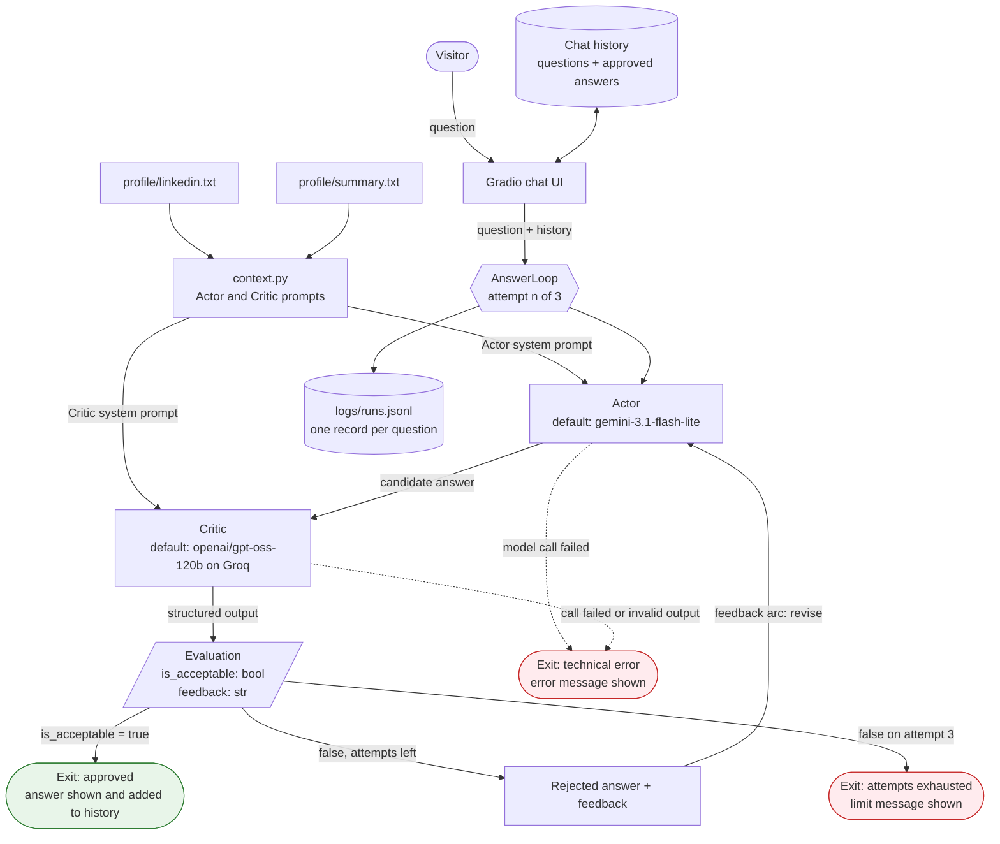

# Architecture

| Exit | When | Shown to the visitor | Run log `outcome` |
|---|---|---|---|
| Approved | The Critic accepts an answer | The answer | `approved` |
| Attempts exhausted | All 3 answers are rejected | A message that no accurate answer was found within 3 attempts | `attempts_exhausted` |
| Technical error | A model call fails, or the Critic output does not match `Evaluation` | A technical error message | `technical_error` |

Each record in `logs/runs.jsonl` holds the scenario ID, the question and the outcome. Each attempt in it holds its number, the candidate answer, the Critic's decision and the feedback, or `evaluation_completed: false` when the evaluation did not finish.
